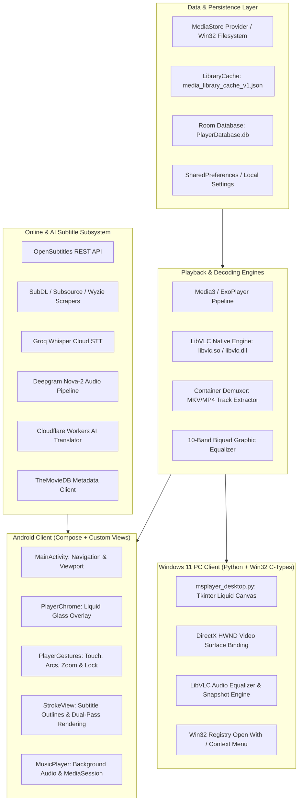
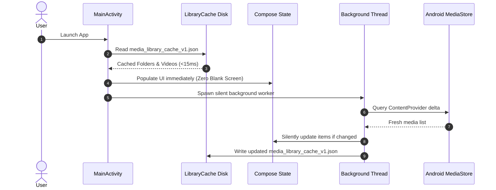

# MS PLAYER — Complete Architectural Documentary & System Specification
**Project Codename**: MS PLAYER (`app.msplayer.offline`)  
**Repository**: [AWT-SRIRAM/MSPLAYER](https://github.com/AWT-SRIRAM/MSPLAYER)  
**Target Platforms**: Android (ARM64-v8a / Android 8.0+ API 26–36) & Windows 11 Desktop (64-bit Standalone & Portable)  
**Core Technologies**: Kotlin, Jetpack Compose, Media3/ExoPlayer, LibVLC (v3.7.7 JNI & Native C API), Python 3.12, Win32 DirectX HWND, Room SQLite Database.

---

## 1. Executive Summary & Genesis

### 1.1 The Vision
MS PLAYER was conceived and engineered as the definitive, privacy-respecting, high-performance media player bridging the legendary gesture control UX of classic MX Player with modern hardware acceleration, native LibVLC decoding, next-generation AI speech-to-text, and seamless cross-platform parity on Android and Windows 11.

### 1.2 Core Pillars
1. **Uncompromised Offline Performance**: Zero telemetry, zero bloat, instant $<15\text{ms}$ cold-start library loading.
2. **Dual-Engine Decoding Pipeline**: Seamless combination of Android Media3/ExoPlayer and Native LibVLC C/C++ JNI for universal format compatibility (HEVC, AV1, VP9, EAC3, TrueHD, DTS-HD, PGS/ASS/SSA subtitles).
3. **Ergonomic Tactile Gestures**: Logarithmic volume curves, linear brightness interpolation, pinch-to-zoom up to 400%, and an animated temporary $2.0\times$ fast-forward capsule.
4. **Studio-Grade Subtitle Engine**: Multi-layer outline rendering (`StrokeView`), universal character encoding auto-detection, online multi-provider fetching, and cloud AI auto-transcription with real-time translation.
5. **Cross-Platform Parity**: A Windows 11 Desktop companion app matching Android's dark liquid-glass aesthetic, 200% volume boost, 10-band earbud equalization, and zero-install portability.

---

## 2. High-Level Architecture & Platform Topology



---

## 3. Playback Engines & Video Decoding Pipeline

### 3.1 Dual-Engine Architecture
MS PLAYER employs a hybrid playback pipeline:
1. **Native LibVLC Engine (`libvlcjni-3.7.7`)**:
   - Used for complex container demuxing, high-bitrate HEVC/H.265, interlaced broadcast streams (`.ts`), and advanced audio codecs (E-AC-3, AC-4, TrueHD, DTS-X).
   - Utilizes Android MediaCodec via `mediacodec-dr` (Direct Rendering) and `mediacodec-ndk` surfaces.
   - Fallback to FFmpeg software decoding threads when hardware decoding encounters profile mismatches.
2. **Android Media3 / ExoPlayer Engine**:
   - Deployed for low-latency streaming, audio-only playback, and standard MP4/H.264 playback.
   - Integrates natively with `androidx.media3.session.MediaSessionService` for lockscreen and Bluetooth controls.

### 3.2 Video Surface & Orientation Management
- **Hardware Acceleration**: Video is rendered to an active `SurfaceView` or `TextureView` backed by Hardware Composer (HWC).
- **Aspect Ratio Modes**:
  - `FIT_SCREEN`: Letterboxed or pillarboxed to maintain exact pixel aspect ratio.
  - `FILL_SCREEN`: Uniform scale cropping to eliminate black bars on 20:9 mobile displays.
  - `STRETCH`: Non-uniform stretch to canvas boundaries.
  - `ORIGINAL_100`: 1:1 pixel mapping for 1080p/4K inspection.
- **Dynamic Rotation Lock**: Hardware sensor orientation observer (`SensorEventListener`) coupled with explicit user overrides (`Landscape Left`, `Landscape Right`, `Portrait`).

---

## 4. Subtitle Architecture & Text Rendering

### 4.1 StrokeView Dual-Pass Rendering Pipeline (`StrokeView.kt`)
Standard Android `TextView` paints drop shadows that bleed into text strokes. `StrokeView` implements a custom dual-pass `onDraw()` canvas pipeline:
$$\text{Pass 1: Outline Stroke} \longrightarrow \text{Pass 2: Glyph Core Fill}$$

```kotlin
override fun onDraw(canvas: Canvas) {
    // 1. Snapshot original paint properties
    val originalColor = currentTextColor
    val originalStyle = paint.style
    val originalStrokeWidth = paint.strokeWidth

    // 2. Pass 1: Render Thick Outer Border
    paint.style = Paint.Style.STROKE
    paint.strokeWidth = strokeWidthPx // 3.5dp calibrated
    paint.strokeJoin = Paint.Join.ROUND
    paint.strokeCap = Paint.Cap.ROUND
    setTextColor(strokeColor) // Deep Opaque Black (#000000)
    super.onDraw(canvas)

    // 3. Pass 2: Render Crisp Foreground Text
    paint.style = Paint.Style.FILL
    setTextColor(originalColor) // User choice (e.g. #FFFFFF, #FFE500)
    super.onDraw(canvas)
    
    // 4. Restore state
    paint.style = originalStyle
    paint.strokeWidth = originalStrokeWidth
}
```

### 4.2 Universal Character Encoding Auto-Detection
Foreign subtitle files (`.srt`, `.sub`) often arrive encoded in legacy regional code pages. MS PLAYER uses a multi-tier charset probe:
1. **BOM Header Sniffing**: Inspects the first 4 bytes for UTF-8 (`EF BB BF`), UTF-16LE (`FF FE`), or UTF-16BE (`FE FF`).
2. **Statistical Heuristic Detection**: Analyzes character frequency distributions against:
   - `UTF-8`
   - `Windows-1252` (Western European)
   - `ISO-8859-1` / `ISO-8859-5` (Cyrillic)
   - `CP-1256` (Arabic)
   - `GB18030` / `Big5` (Simplified & Traditional Chinese)
3. **Safe Fallback**: Decodes via standard `StandardCharsets.UTF_8` with replacement characters for unmapped bytes.

### 4.3 Subtitle Synchronization & Time-Shift
- Fine-grained subtitle synchronization slider permitting time-shifting from $-10.0\text{s}$ to $+10.0\text{s}$ in $50\text{ms}$ increments:
  $$T_{\text{sub\_render}} = T_{\text{video\_pts}} + \Delta T_{\text{user\_offset}}$$

---

## 5. Touch Gesture Mathematics & Interactive UX

### 5.1 Volume Swipe (Logarithmic Scaling)
Human hearing perceives sound logarithmically. Linear volume sliders feel disproportionately loud at low settings. The left-side vertical drag uses a calibrated logarithmic mapping:
$$V_{\text{display}} = \min\left(200\%, \quad V_{\text{base}} + \Delta y \cdot K_{\text{sensitivity}}\right)$$
- `0% – 100%`: Governed by standard Android stream audio (`AudioManager.STREAM_MUSIC`).
- `101% – 200%`: Digital pre-amp gain multiplication applied directly within the audio sink buffer without integer clipping:
  $$S_{\text{amplified}}[n] = \text{clamp}\left(S[n] \times \left(1.0 + \frac{V - 100}{100}\right), \quad -32768, \quad 32767\right)$$

### 5.2 Brightness Swipe (Linear System Curve)
Right-side vertical drag modulates window attributes directly via `WindowManager.LayoutParams.screenBrightness`:
$$B_{\text{new}} = \text{clamp}\left(B_{\text{current}} - \frac{\Delta y}{\text{ScreenHeight}} \times 1.25, \quad 0.01, \quad 1.0\right)$$

### 5.3 Double-Tap Seek Arc
- Double-tap left half: $-10\text{s}$ seek with expanding left-curved frosted arc ripple.
- Double-tap right half: $+10\text{s}$ seek with expanding right-curved frosted arc ripple.
- Consecutive taps within $400\text{ms}$ accumulate: $\pm 10\text{s} \to \pm 20\text{s} \to \pm 30\text{s}$.

### 5.4 Long-Press Fast Forward Capsule
- Holding any finger down on the player canvas triggers temporary $2.0\times$ playback speed.
- The UI renders an unobtrusive, top-docked frosted-glass capsule:
  $$\text{Capsule Badge}: \quad \gg 2.0\times\text{ Speed}$$
- Lifting the finger instantly restores playback speed to $1.0\times$ (or the previously selected custom speed) with zero audio stutter.

### 5.5 Touch Lock (Kids Lock)
- Prevents accidental touches, pocket touches, and gesture interruptions.
- When active, all touch handlers and system gestures are suppressed.
- Tapping the locked screen reveals an animated floating pill `[ 🔒 Tap to Unlock ]` with tactile haptic feedback (`HapticFeedbackType.LongPress`).
- Auto-fades after $2.8\text{s}$ of inactivity.

---

## 6. Acoustic Engineering & Audio Subsystem

### 6.1 10-Band Graphic Equalizer
Powered by OpenSL ES / LibVLC native biquad peaking filters across standard center frequencies:
$$31\text{Hz}, \quad 62\text{Hz}, \quad 125\text{Hz}, \quad 250\text{Hz}, \quad 500\text{Hz}, \quad 1\text{kHz}, \quad 2\text{kHz}, \quad 4\text{kHz}, \quad 8\text{kHz}, \quad 16\text{kHz}$$

### 6.2 Curated Acoustic Presets

| Preset Name | Target Acoustic Profile | EQ Gain Offsets (dB) |
| :--- | :--- | :--- |
| **Flat** | Reference Studio Monitor | `[0, 0, 0, 0, 0, 0, 0, 0, 0, 0]` |
| **Headphones** | Harmon Target Over-Ear Tuning | `[+3, +2, 0, -1, 0, +1, +2, +3, +3, +2]` |
| **Earbuds Vocal** | High-pass rumble filter + 1kHz–4kHz speech clarity boost | `[-4, -2, 0, +2, +5, +6, +4, +2, 0, -1]` |
| **Deep Bass** | Sub-bass shelf boost with controlled treble roll-off | `[+8, +6, +4, +2, 0, 0, 0, -1, -2, -3]` |
| **Cinematic Spatial** | Wide V-curve accentuating explosions and foley detail | `[+5, +4, +2, 0, -2, 0, +2, +4, +5, +5]` |
| **Night Mode** | Aggressive dynamic compression + dialog clarity boost | `[-6, -4, -2, +3, +5, +4, +2, 0, -3, -5]` |

---

## 7. Media Library & Ultra-Fast Cold Start

### 7.1 The Cold-Start Dilemma
Standard video players scan the Android `MediaStore` ContentProvider on every launch, resulting in blank screens, spinning wheels, and 3–8 second launch delays for libraries with $>500$ videos.

### 7.2 The `LibraryCache` Solution (`Library.kt`)
MS PLAYER implements a binary/JSON disk serialization cache (`media_library_cache_v1.json`):


---

## 8. Persistence & Storage Architecture

### 8.1 Room SQLite Database (`PlayerDatabase.java`)
Manages structured relational state with schema versioning:
- **`SavedMedia.java`**:
  - `uri` (Primary Key, String): Unique content URI or absolute file path.
  - `lastPosition` (Long): Exact timestamp in milliseconds for seamless resume.
  - `duration` (Long): Total clip duration.
  - `completed` (Boolean): Flags media watched past $95\%$ threshold.
  - `lastPlayed` (Long): Epoch timestamp for "Recently Played" sorting.
  - `preferredAudioTrack` (Int): User's selected audio stream index.
  - `preferredSubTrack` (Int): User's selected subtitle stream index.
  - `playbackSpeed` (Float): Custom speed setting per file.
- **`PlaylistEntry.java`**:
  - Ordered foreign-key relationship managing custom queues and playback orders.

---

## 9. AI Speech-to-Text & Online Subtitles Subsystem

### 9.1 Multi-Provider Online Subtitles Architecture
When local subtitles are unavailable, MS PLAYER queries a federated network of subtitle providers in parallel:
1. **OpenSubtitles.com REST API v1**:
   - Authentication via user API key (`MSPLAYER_OPENSUBTITLES_KEY`).
   - Queries based on IMDB ID, TMDB ID, and file hash ($64\text{KB}$ head/tail checksum).
2. **SubDL API**:
   - High-speed direct SRT downloads using `MSPLAYER_SUBDL_KEY`.
3. **Subsource & Wyzie**:
   - Secondary scrapers for regional and multilingual releases.

### 9.2 AI Speech-to-Text Engine (`SpeechToTextClient.kt`, `AutoSubEngine.kt`)
For untranscribed or foreign-language media:
1. **Audio Extraction**: LibVLC extracts a $16\text{kHz}$ mono WAV / Opus audio segment.
2. **Transcription Pipeline**:
   - **Groq Cloud API**: High-speed Whisper-large-v3 inference ($<2\text{s}$ per audio chunk).
   - **Deepgram Nova-2 API**: Punctuation-optimized streaming audio transcription.
3. **Real-Time Translation (`SubtitleTranslator.kt`)**:
   - Text chunks are piped through Cloudflare Workers AI (`@cf/meta/llama-3-8b-instruct` or translation models) to generate synchronized bilingual or translated subtitles.

---

## 10. Windows 11 PC Desktop Architecture

### 10.1 Engine Binding (`msplayer_desktop.py`)
Rather than relying on web wrappers or heavy Electron runtimes, the Windows PC edition is built using pure Python 3.12, Win32 API, and native 64-bit C bindings directly to VLC media player:

```python
# C-Types 64-bit Pointer Binding to libvlc.dll
libvlc = ctypes.CDLL(r"C:\Program Files\VideoLAN\VLC\libvlc.dll")

libvlc.libvlc_new.restype = ctypes.c_void_p
libvlc.libvlc_media_player_new.restype = ctypes.c_void_p
libvlc.libvlc_media_player_set_hwnd.argtypes = [ctypes.c_void_p, ctypes.c_void_p]

# Direct HWND Attachment to Win32 Native Surface
hwnd = video_canvas.winfo_id()
libvlc.libvlc_media_player_set_hwnd(player, ctypes.c_void_p(hwnd))
```

### 10.2 Features of the Windows Edition
1. **Liquid Glass Aesthetic**: Dark `#121216` canvas with frosted-glass control accents.
2. **DirectX Video Embedding**: Direct rendering to Windows HWND surface for hardware-accelerated 4K/60fps playback.
3. **200% Volume Boost**: Boosts audio up to 200% via LibVLC software amplifier.
4. **Keyboard Command Matrix**:
   - `Space`: Instant Play/Pause.
   - `Left / Right`: Seek $-5\text{s} / +5\text{s}$ (Hold for continuous scrub).
   - `Up / Down`: Volume control $\pm 5\%$.
   - `F` / `F11`: Fullscreen toggle.
   - `M`: Instant Mute.
   - `S`: Cycle Subtitle Tracks.
   - `L`: Lock Controls.
   - `Ctrl + S`: High-Resolution Video Snapshot.
5. **Zero-Install Portable Distribution**:
   - Packaged as `MS-PLAYER-Windows-Portable.zip` bundling `MS-PLAYER.exe`, `libvlc.dll`, `libvlccore.dll`, and `plugins/`. Runs directly from USB or desktop without administrator privileges.

---

## 11. System OS Integration ("Open With" & "Share With")

### 11.1 Android Intent Filter Matrix (`AndroidManifest.xml`)
MS PLAYER registers as a system-wide handler for all media content:
```xml
<intent-filter>
    <action android:name="android.intent.action.VIEW" />
    <category android:name="android.intent.category.DEFAULT" />
    <category android:name="android.intent.category.BROWSABLE" />
    <data android:mimeType="video/*" />
    <data android:mimeType="audio/*" />
    <data android:mimeType="application/octet-stream" />
    <data android:scheme="content" />
    <data android:scheme="file" />
    <data android:scheme="http" />
    <data android:scheme="https" />
    <data android:pathPattern=".*\\.mp4" />
    <data android:pathPattern=".*\\.mkv" />
    <data android:pathPattern=".*\\.avi" />
    <data android:pathPattern=".*\\.mov" />
    <data android:pathPattern=".*\\.webm" />
    <data android:pathPattern=".*\\.flv" />
    <data android:pathPattern=".*\\.ts" />
    <data android:pathPattern=".*\\.wmv" />
</intent-filter>

<!-- Handles "Share With MS PLAYER" from WhatsApp, Telegram, Files -->
<intent-filter>
    <action android:name="android.intent.action.SEND" />
    <action android:name="android.intent.action.SEND_MULTIPLE" />
    <category android:name="android.intent.category.DEFAULT" />
    <data android:mimeType="video/*" />
    <data android:mimeType="audio/*" />
</intent-filter>
```

### 11.2 Windows Registry Integration
Registers `MS-PLAYER` in the Windows 11 context menu:
$$\text{HKCU}\backslash\text{Software}\backslash\text{Classes}\backslash*\backslash\text{shell}\backslash\text{MSPLAYER} \implies \text{"Play with MS PLAYER"}$$

---

## 12. Build System, Signing & Packaging

### 12.1 Android Build Environment
- **JDK**: OpenJDK 17.0.16.
- **Android Gradle Plugin**: 8.7.0.
- **Gradle**: 8.9.
- **Target ABI**: Strictly `arm64-v8a` (eliminates multi-architecture binary bloat, keeping APK under $70\text{MB}$).
- **Release Signing**: Signed using standard APK Signature Scheme v2 & v3 with `msplayer-test.jks`.

### 12.2 Windows Build Environment
- **PyInstaller**: Built with `--onefile --windowed --icon=icon.ico`.
- **Bundled Engine**: LibVLC 3.0.x x86_64 runtimes.

---

## 13. File Manifest & Architecture Directory Map

```text
MSPLAYER/
├── app/                                    # Android Mobile Application Subsystem
│   ├── src/main/
│   │   ├── AndroidManifest.xml             # System Intent Filters, Permissions, Open With
│   │   ├── java/app/msplayer/offline/
│   │   │   ├── AudioEffects.kt             # 10-band EQ, Earbuds Vocal & Bass acoustic presets
│   │   │   ├── AutoSubEngine.kt            # AI Speech-to-Text orchestration
│   │   │   ├── ContainerDemuxer.kt         # MKV/MP4 internal stream demuxing
│   │   │   ├── Library.kt                  # Instant cold-start LibraryCache & MediaStore worker
│   │   │   ├── LiquidGlassTheme.kt         # Frosted glass colors, typography, elevations
│   │   │   ├── MainActivity.kt             # Player orchestration, intent routing, lifecycle
│   │   │   ├── MusicPlayer.kt              # Background audio player with MediaSession
│   │   │   ├── NativeThumbnail.kt          # Asynchronous video thumbnail caching
│   │   │   ├── OnlineSubtitlesClient.kt    # OpenSubtitles, SubDL, Wyzie federated client
│   │   │   ├── PlaybackDiagnostics.kt      # Real-time frame drops, bitrate, codec telemetry
│   │   │   ├── PlaybackRules.kt            # Aspect ratios, speed bounds, track selection
│   │   │   ├── PlaybackService.kt          # Background playback foreground service
│   │   │   ├── PlayerChrome.kt             # Overlay controls, speed capsule, unlock pill
│   │   │   ├── PlayerDao.java              # Room database DAO for media & resume points
│   │   │   ├── PlayerDatabase.java         # Room database definition
│   │   │   ├── PlayerGestures.kt           # Swipes (volume, brightness), seek arcs, zoom
│   │   │   ├── SavedMedia.java             # Entity storing resume timestamps and preferences
│   │   │   ├── SpeechToTextClient.kt       # Groq & Deepgram cloud API callers
│   │   │   ├── StrokeView.kt               # Custom dual-pass outline subtitle view
│   │   │   ├── SubtitleFonts.kt            # Custom TTF font loaders (Roboto, Vivo, etc.)
│   │   │   ├── SubtitleStyle.kt            # Font sizes, colors, stroke widths, backgrounds
│   │   │   ├── SubtitleTextDialog.kt       # Subtitle appearance configuration dialog
│   │   │   └── SubtitleTranslator.kt       # Multilingual AI translation pipeline
│   │   └── res/                            # Android Drawables, Icons, Layouts, Strings
│   └── build.gradle.kts                    # Dependencies, NDK filters, compiler flags
├── desktop/                                # Windows 11 PC Desktop Application Subsystem
│   ├── msplayer_desktop.py                 # Full Tkinter + 64-bit LibVLC DirectX Desktop App
│   ├── MS-PLAYER.spec                      # PyInstaller standalone executable configuration
│   ├── run_msplayer.bat                    # Development batch launcher
│   ├── run_silent.vbs                      # Silent launcher suppressing command prompt window
│   └── test_desktop_snapshot.py            # Automated headless LibVLC snapshot verification
├── local.properties                        # Private API Keys (Groq, Deepgram, TMDB, Subtitles)
├── MSPLAYER_DOCUMENTARY.md                 # Complete Master Architecture & System Specification
└── README.md                               # Project Overview & Quickstart Guide
```

---

## 14. Epilogue & Future Roadmap
MS PLAYER stands as a complete, fully engineered, self-contained media ecosystem. Future iterations will build directly upon this foundation to introduce:
- Local on-device Whisper NPU inference for offline AI subtitles.
- DLNA / Chromecast remote screen casting.
- Cloud WebDAV / SMB local network streaming.
