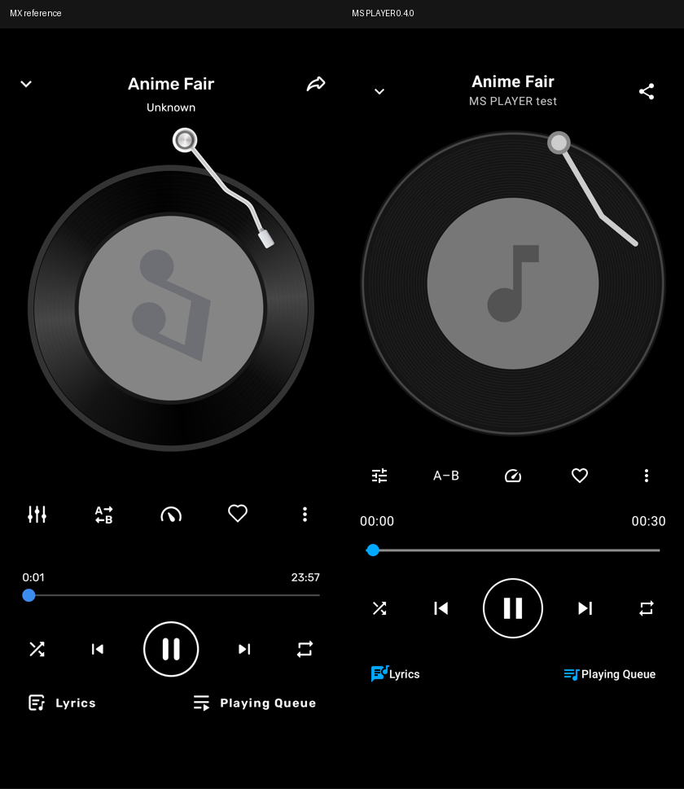
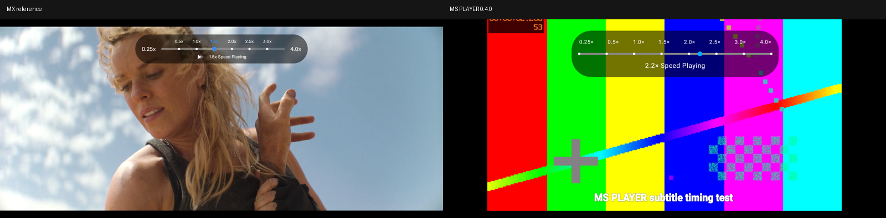

# MS PLAYER

Offline, ad-free Android multimedia player built with Kotlin, Jetpack Compose, and LibVLC Android 3.7.7. Current review source: **0.5.0**, versionCode **6**, package `app.msplayer.offline`.

Primary device target: iQOO Neo10R running Android 16. Minimum Android API 26; compile/target API 36.

## Features

- Local video/audio library, folders, playlists, history, resume, and video thumbnails.
- Hardware-first playback with Auto, Hardware, and Software decoder modes.
- SRT/ASS/PGS selection, subtitle delays, appearance controls, and available Android font families.
- Swipe seeking, pinch zoom, left-side brightness and right-side volume gestures, with opposite-side feedback indicators.
- Hold for 400 ms and drag horizontally for temporary 0.25x-4x speed; release restores the previous rate.
- Volume gain up to 200%, audio effects, and manual equalizer.
- Record-style music screen, artwork/metadata, queue, shuffle/repeat, favourites, A-B controls, offline USLT/LRC/text lyrics, and mini-player.
- Picture-in-picture, optional background audio, and explicit resource cleanup on Exit/task removal.

The app requests no Internet permission and includes no advertising service. The interface was developed using user-supplied MX Player references; this is an independent implementation and is not affiliated with MX Player.

## Build

Install JDK 17 and Android SDK API 36 with Build Tools 36.0.0. Configure `JAVA_HOME` and `ANDROID_HOME`, or provide an untracked `local.properties` with `sdk.dir=<SDK path>`. Gradle requires Internet access on the build computer to resolve dependencies.

```powershell
.\gradlew.bat assembleDebug testDebugUnitTest lintDebug
```

On macOS/Linux, use `./gradlew`. Debug installs as `app.msplayer.offline.debug` (MS PLAYER DEBUG), separately from the everyday app. The test runner refuses the release package. Default native ABI is ARM64; debug APK output is `app/build/outputs/apk/debug/app-debug.apk`.

Pinned tooling: Gradle 8.11.1, AGP 8.10.1, Kotlin/Compose compiler 2.1.20. Gradle wrapper and distribution checksum are included.

### Android tests

Use an Android device or emulator. For an x86_64 emulator:

```powershell
.\gradlew.bat connectedDebugAndroidTest -PtestAbi=x86_64
```

Omit `-PtestAbi` for an ARM64 device. Instrumentation fixtures live in `app/src/androidTest/assets`; they are not packaged in the ordinary player APK. The explicit two-install upgrade test skips unless its phase argument is supplied; see [release history](docs/RELEASE-HISTORY.md) and [verification report](docs/VERIFICATION-0.4.0.md).

### Signed release

Supply your own signing key (alias `msplayer`) through `MSPLAYER_KEYSTORE` and `MSPLAYER_STORE_PASSWORD`, then run:

```powershell
.\gradlew.bat assembleRelease testReleaseUnitTest lintRelease
```

The original signing key is excluded. An independently signed APK cannot update an installation signed with another certificate.

## Verification and limits

Version 0.5.0 adds continuous subtitle size/scale, exact migration of old defaults, a transactional Text dialog, encoding selection, native-inset compensation, and placement against the measured timeline boundary. ASS/PGS stay native. See [0.5.0 verification](docs/VERIFICATION-0.5.0.md) for phone/emulator results and measured residuals.

The controlled iQOO comparison meets the approximate cap-height and bottom-clearance targets; native bold weight and multiline pitch still differ from MX. This is a review build, without a claim of pixel parity. Subtitle gestures/folder selection remain scheduled for 0.5.1; cue scroll and fade are deferred. The native surface alpha probe had no effect.

The [0.4.0 verification](docs/VERIFICATION-0.4.0.md) remains historical evidence. Sustained high-bitrate performance, HDR/Dolby Vision colour and audio-route comfort are not established by this subtitle update. AC3/EAC3 decoding does not imply Dolby Atmos certification or surround passthrough.

Arial/Droid font choices require actual device-installed families. Another app's private Android `IS_PENDING` downloads remain inaccessible; incomplete files may not play or seek. Exact MX thumbnail frames and pixel parity are not established.

## Reference comparisons

These are layout comparisons using user-supplied reference captures. The speed comparison uses different clips and does not establish colour/subtitle parity.





## Source and licensing

Application code is provided under [MIT](LICENSE), subject to the exclusions and dependency terms in [third-party notices](THIRD-PARTY-NOTICES.md). Engine source snapshots and licence texts are retained in `third_party` and `app/src/main/assets/licenses`.

The existing launcher artwork, reference screenshots, and upstream test media retain their respective third-party rights and are not covered by the application's MIT grant. See the notices and [release history](docs/RELEASE-HISTORY.md) for provenance and LibVLC replacement/relinking instructions.

[0.5.0 source provenance](docs/SOURCE-PROVENANCE-0.5.0.json) · [0.4.0 provenance](docs/SOURCE-PROVENANCE.json)
