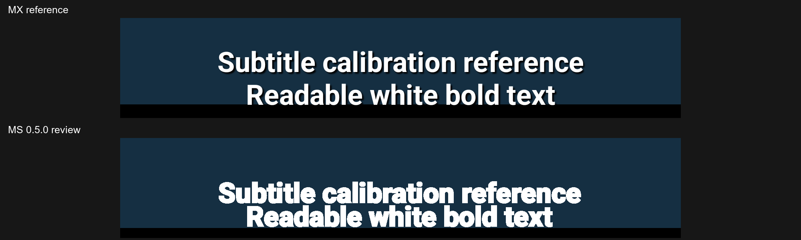

# MS PLAYER 0.5.0 verification

Date: 2026-10-17. Review branch: `subtitle-0.5.0`, based on preserved `v0.4.0`. Release package `app.msplayer.offline`, versionCode 6, ARM64, LibVLC Android 3.7.7. The everyday phone installation was not replaced or preference-cleared.

## Implemented

- Fixed FreeType relative size 17; Size 10–60 and Scale 50–300%, with effective native scale bounded to 10–500.
- White bold default, border/background off, shadow opacity 140. Border opacity defaults to 80%; custom thickness, opacity and shadow are retained.
- Exact old default tuple migrates to the new preset with its font retained. All five regular and five legacy size steps have tested conversions. Custom layouts retain their native inset and legacy source margin.
- Transactional dark Text dialog: font, size, scale, colour/bold, background, border, shadow, layout, encoding, RESET/CANCEL/OK. Only OK applies. No-op and position-only changes preserve the renderer and temporary playback speed.
- Source-confirmed VLC `substext.h` intrinsic 4% inset is removed for new presets. The timeline's measured upper boundary controls live lifting. Repeated placement updates remove the existing translation from coordinate calculations to avoid feedback drift. Authored ASS/PGS are excluded from these translations.
- Ten encoding choices. BOM-marked UTF-16 is normalized by VLC's demuxer before its UTF-8 decoder; forcing a second UTF-16 decode was found and fixed.
- Debug suffix `.debug`, separate app label, and a test runner that rejects the everyday release package.

## Validation

- Debug and release builds: passed; 17 JVM tests per variant, zero failures. Lint: zero errors (existing warnings remain).
- Physical Android API 36 iQOO: surface spike, dialog transaction checks, equivalent CP1252/UTF-8/UTF-16/Auto decoding, live placement, paused intent/rate/delay preservation, native rendering and timeline pixel-overlap checks passed. English/Tamil lossless captures inspected for shaping and clipping.
- Existing phone playback tests passed for AC3/EAC3, embedded SRT/ASS, PGS/content URI, track switching/delay, resume/history/playlists, orientation/PiP, effects, thumbnails, demanding-file diagnostics and shutdown. These are functional checks, not performance or audio-quality guarantees.
- Broad emulator run: 14 of 15 tests passed and one exposed timeline overlap. That defect was fixed using measured control bounds; the rendering/state checks passed on targeted phone and emulator reruns. Earlier readiness/pause timing failures and the UTF-16 failure are retained in local diagnostic logs rather than hidden.
- Final emulator race check passed: an explicit Disable while reopening overrides the prior subtitle selection. Physical rerun of that last race check was unavailable after USB disconnected; the earlier phone state/placement checks passed.
- Genuine two-install 0.4.0 → 0.5.0 debug upgrades passed for untouched defaults and customized settings, including history/playlists. Release certificate matches the existing identity. The release APK was not installed over the user's everyday app during tests.
- Native libraries are byte-identical to delivered 0.4.0. Permissions unchanged; no INTERNET or all-files access; no new libraries. Release contains no instrumentation media. APK signature, ZIP and native ELF 16 KB alignment checked.

## Physical comparison and limits

Lossless 2800×1260 captures use the same phone, wide fixture, embedded English track, static video frame/cue, landscape orientation and Fit mode. The fixture's constant cue avoids a different-word comparison; captures are around 2–4 seconds, so exact timestamp/frame synchronization on a real movie is NOT established. The user's local movie was opened in both apps, but the selected 10-minute position contained no active subtitle and was excluded from glyph measurements.

| Measurement | MX 3.3.1 | MS 0.5.0 | Result |
|---|---:|---:|---|
| Measured video height | 1172 px | 1190 px | Slight native surface-size difference |
| First-line cap height | 54 px | 56 px | +2.1% after normalizing to video height; within approximate 5% target |
| Line pitch | 83 px | 60 px | −28.8% normalized; target NOT met |
| Last-line clearance | −2 px | 2 px | Near the video edge, within approximate 1%; MX glyphs extend slightly beyond the colour rectangle |

MS native bold remains visibly heavier and multiline spacing tighter. They are unresolved renderer differences, not a claim of a 99% match. VLC's exposed options do not provide a line-pitch control. No arbitrary saturation/colour filter or replacement renderer was added to hide the difference.

The real MX Text settings showed **Default** font, Size 23, Scale 100%, white/bold, background/border off, border opacity 80%. On this iQOO, the default system family is vendor-mapped; “Roboto” had previously been misidentified through a condensed family. The new default follows the actual Default reference; regular Roboto is only offered when its non-condensed mapping exists. Customized old Roboto mappings are retained internally until the user explicitly changes font. No proprietary font was copied.

The phase-0 native surface probe measured approximately 1.5× scaling and working translation in Auto/Software. Alpha 0.3 produced luminance ratio 1.0, so fade is deferred. No 0.5.1 subtitle gestures/folder or later cue-navigation/fade work is included.

Remaining: rapid pause during startup rotation can leave a stale/smaller native video buffer; the fixed-orientation calibration does not resolve or validate that case. Also pending: exact real-movie cue/frame calibration, native weight/line-pitch match, broader device/font/orientation coverage and subjective readability. Sustained iQOO high-bitrate performance, HDR colour, Bluetooth/surround output and all locale encodings are not proven by these checks. Zero bottom clearance passed the inspected English/Tamil fixtures; it is not a guarantee for every authored subtitle.

## Local evidence and delivery

APK: `MS-PLAYER-0.5.0-arm64.apk`; source: `MS-PLAYER-0.5.0-source.zip`. Lossless captures/metrics: `previews/0.5.0`. Local test/package evidence: `verification/0.5.0`. Private recordings, signing keys, caches and device logs are excluded from the source archive. The review branch is local; main and v0.4.0 are unchanged.

